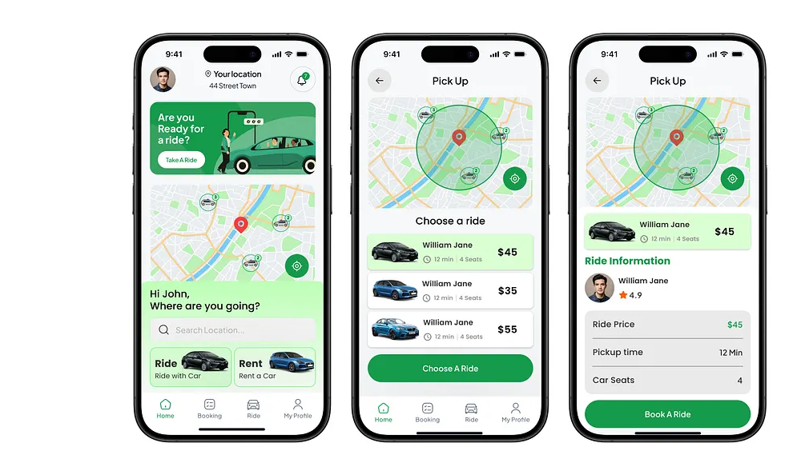

# Fast Logistics mobile UI guide

The app follows the [reference screenshots](references/indrive/) for layout and
flow, and uses its own colors, copy, and artwork. Dark is the default theme and
matches the references. Light uses white surfaces. People choose under
**Settings → Appearance**. Both themes live in `apps/mobile/lib/app_theme.dart`.

| Color | Role |
| --- | --- |
| `#00022A` | Main text in light theme and text on sky blue |
| `#010F55` | Deep navy for the delivery banner and selected rows |
| `#0654B0` | The primary blue: main buttons, map pins, and selected states in both themes |
| `#50A5D8` | Illustration details, and small accents such as text or stars on dark surfaces, where `#0654B0` is too dark to read |

Keep the map, offer cards, and primary actions readable at larger text sizes.

Use Flutter Map with a configured tile source. Set `TRIP_MAP_TILE_URL_DARK` to
a dark basemap for production. Without it, dark theme applies a night filter to
the light basemap. Keep the map provider attribution visible.

Shared map controls, panels, sheets, and settings rows are in
`apps/mobile/lib/ui_kit.dart`. Reuse them for new screens.

## Map, rider offers, and confirmation

| Reference screen | Fast Logistics layout |
| --- | --- |
| Home | Lead with pickup and drop-off on the map. Put the new delivery action and route entry within easy reach. |
| Choose a ride | Keep route context above a list of actual rider offers. Give the fare and selection state clear visual priority. Show rider details only when supplied by the API. |
| Ride information | Review the selected rider, agreed fare, and payment method before confirming. Keep the confirmation action prominent. |

Use parcel delivery terminology. The example’s coverage circle, ETAs, and
ratings are visual references for data-backed states. The example’s green
palette, passenger seat counts, rentals, and prices belong to the reference.

See also the [booking and tracking reference](mobile-app-reference.png).

## Sign-up and sign-in

Follow the [onboarding and welcome reference](references/auth/onboarding-and-welcome-reference.png)
for the welcome headline and pill button, progress steps, and phone code boxes.
These screens stay light in every appearance. Use the blue palette in place of the
reference’s green, and original artwork from `apps/mobile/lib/auth_art.dart`.

## Additional screenshots

- [Full-screen booking map](references/full-screen-booking-map.jpg)
- [Street-level map and vehicle marker reference](references/street-level-bike-map.jpg)

### inDrive screen references

- [Home while locating](references/indrive/Screenshot_20261107_110959_inDrive.jpg.jpeg)
- [Home with pickup prompt](references/indrive/Screenshot_20261107_111005_inDrive.jpg.jpeg)
- [Route entry](references/indrive/Screenshot_20261107_111034_inDrive.jpg.jpeg)
- [Pickup pin confirmation](references/indrive/Screenshot_20261107_111040_inDrive.jpg.jpeg)
- [Booking map while loading the fare](references/indrive/Screenshot_20261107_111050_inDrive.jpg.jpeg)
- [Booking map with recommended fare](references/indrive/Screenshot_20261107_111107_inDrive.jpg.jpeg)
- [Booking map with adjusted fare](references/indrive/Screenshot_20261107_111133_inDrive.jpg.jpeg)
- [Address search results](references/indrive/Screenshot_20261107_111157_inDrive.jpg.jpeg)
- [Booking options](references/indrive/Screenshot_20261107_111218_inDrive.jpg.jpeg)
- [Payment method selection](references/indrive/Screenshot_20261107_111226_inDrive.jpg.jpeg)
- [Multi-stop route](references/indrive/Screenshot_20261107_111325_inDrive.jpg.jpeg)
- [Multi-stop route with capture overlay](references/indrive/Screenshot_20261107_111326_inDrive.jpg.jpeg)
- [Identity verification prompt, duplicate capture](references/indrive/Screenshot_20261107_111344_inDrive.jpg%20%281%29.jpeg)
- [Identity verification prompt](references/indrive/Screenshot_20261107_111344_inDrive.jpg.jpeg)
- [Home with pickup selected](references/indrive/Screenshot_20261107_111418_inDrive.jpg.jpeg)
- [Navigation drawer](references/indrive/Screenshot_20261107_111507_inDrive.jpg.jpeg)
- [Order history](references/indrive/Screenshot_20261107_111518_inDrive.jpg.jpeg)
- [App settings](references/indrive/Screenshot_20261107_111532_inDrive.jpg.jpeg)
- [In-app chat explainer](references/indrive/Screenshot_20261107_111627_inDrive.jpg.jpeg)
- [Phone number privacy explainer](references/indrive/Screenshot_20261107_111636_inDrive.jpg.jpeg)
- [Profile photo explainer](references/indrive/Screenshot_20261107_111703_inDrive.jpg.jpeg)
- [Support chat empty state](references/indrive/Screenshot_20261107_111714_inDrive.jpg.jpeg)
- [Emergency contacts](references/indrive/Screenshot_20261107_111725_inDrive.jpg.jpeg)
- [Add an emergency contact](references/indrive/Screenshot_20261107_111736_inDrive.jpg.jpeg)
